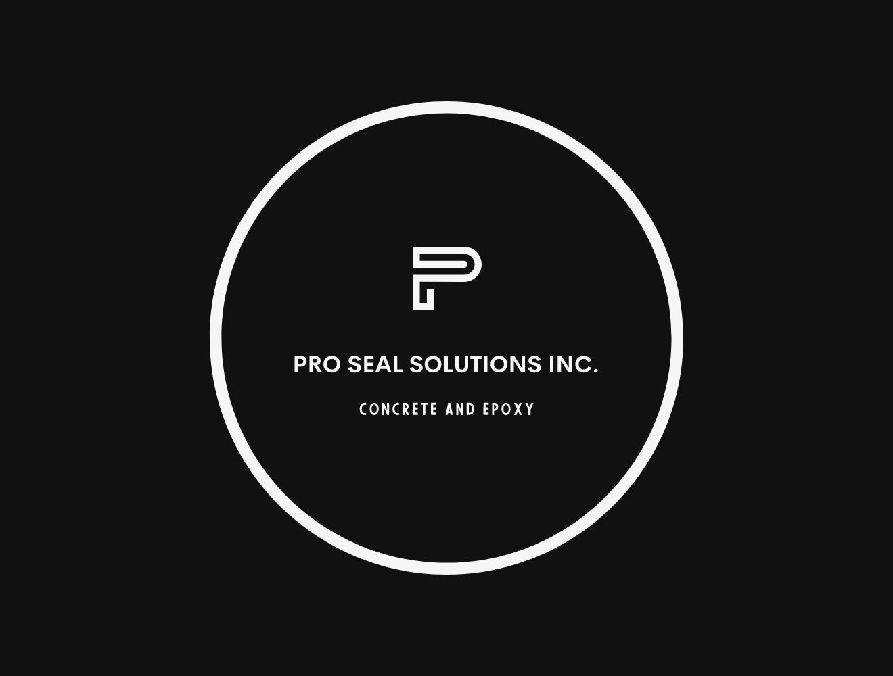
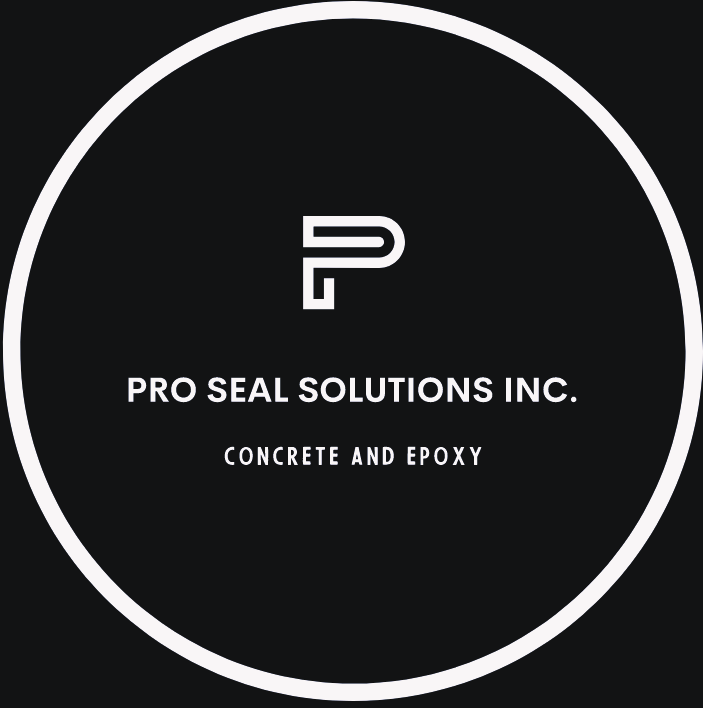

# Logos / Branding Assets

This file maps the logo assets for the Pro Seal Solutions Inc. website.

Purpose:
- Help the AI agent understand which logo files are available.
- Define where each logo should be used.
- Prevent logo files from being confused with project/gallery images.
- Provide suggested alt text and implementation notes.

Important:
- Logo files are branding assets, not gallery/project photos.
- Do not display logo files inside the projects gallery.
- Do not treat logo files as examples of epoxy flooring, concrete coatings, or restoration work.
- Use logo files only for branding, website identity, favicon/app icons, and social preview assets if suitable.

---

## Available Logo Files

| File | Role | Recommended Use |
|---|---|---|
| `assets/logo/logo.png` | Primary logo | Header, main branding, footer |
| `assets/logo/logo-square-fit.png` | Square/compact logo | Favicon, app icon, mobile/compact areas |

---

# Primary Logo

File:
`assets/logo/logo.png`

Recommended use:
- Main website header
- Hero section if needed
- Footer branding
- Desktop navigation
- Main company identity placement
- Social preview image base if it fits the layout

Suggested role:
Primary brand logo

Suggested alt text:
Pro Seal Solutions Inc. logo

Suggested image label:
Primary logo

Implementation notes:
- Use this as the default logo for the website.
- Use it in the header unless it is too wide for the layout.
- Check that it remains readable on light backgrounds.
- Check that it remains readable on dark or footer backgrounds.
- If the logo has a transparent background, preserve transparency.
- Do not stretch, squash, crop, or distort the logo.
- Maintain original aspect ratio.
- Add proper width and height attributes in final website code to prevent layout shift.
- Do not use this logo as a project/gallery image.
- Do not use this logo as a background pattern.

Recommended HTML usage:

```html

```

Alternative accessible usage when the company name appears as visible text beside the logo:

```html

```

Use empty alt text only when “Pro Seal Solutions Inc.” is already visible as real text near the logo.

---

## Primary Logo Usage by Website Area

### Header

Preferred file:
`assets/logo/logo.png`

Usage:
- Place the logo on the left side of the header.
- Link the logo to the top of the homepage.
- Keep it visible and readable on mobile.
- Keep enough space for the phone CTA and quote CTA.
- Do not make the logo so large that it pushes contact actions below the fold.

Suggested alt text:
Pro Seal Solutions Inc. logo

### Hero Section

Preferred file:
`assets/logo/logo.png`

Usage:
- Optional if the logo is already visible in the header.
- Avoid repeating the logo too many times above the fold.
- Prioritize the headline, service message, and quote button.

Suggested alt text:
Pro Seal Solutions Inc. logo

### Footer

Preferred file:
`assets/logo/logo.png`

Alternative:
`assets/logo/logo-square-fit.png`

Usage:
- Use whichever version is more readable on the footer background.
- If the footer uses a dark graphite background, confirm that the logo has enough contrast.
- If contrast is poor, use the company name as text instead of forcing the logo.

Suggested alt text:
Pro Seal Solutions Inc. logo

---

# Square-Fit Logo

File:
`assets/logo/logo-square-fit.png`

Recommended use:
- Favicon source if suitable
- App icon source if suitable
- Mobile header if the primary logo is too wide
- Social media profile image
- Small branding areas
- Footer compact logo
- Compact card or badge layouts
- Open Graph/social preview image base if needed

Suggested role:
Compact / square logo version

Suggested alt text:
Pro Seal Solutions Inc. square logo

Suggested image label:
Square logo

Implementation notes:
- Use this version where a square or compact format is required.
- Good candidate for favicon or mobile display, but verify visual clarity at small sizes.
- Check readability at 32x32, 48x48, 180x180, 192x192, and 512x512 sizes.
- Do not use this in the main header if the full primary logo works better.
- Maintain original aspect ratio.
- Do not stretch, squash, crop, or distort the logo.
- Do not crop further unless needed for favicon generation.
- Do not use this logo as a project/gallery image.
- Do not use this logo as a background pattern.

Recommended HTML usage:

```html

```

Alternative accessible usage when the company name appears as visible text beside the logo:

```html

```

Use empty alt text only when “Pro Seal Solutions Inc.” is already visible as real text near the logo.

---

## Square-Fit Logo Usage by Website Area

### Mobile Header

Preferred file:
`assets/logo/logo-square-fit.png`

Use when:
- The primary logo is too wide for the mobile header.
- The mobile header needs a compact brand mark.
- The phone/quote buttons need more horizontal space.

Do not use when:
- The primary logo remains readable and fits cleanly.

Suggested alt text:
Pro Seal Solutions Inc. square logo

### Favicon / App Icons

Preferred source:
`assets/logo/logo-square-fit.png`

Recommended generated files:
- `favicon.ico`
- `favicon-32x32.png`
- `favicon-16x16.png`
- `apple-touch-icon.png`
- `android-chrome-192x192.png`
- `android-chrome-512x512.png`

Implementation notes:
- Generate favicon/app icons from the square logo if it is readable at small sizes.
- If the square logo is too detailed, create a simplified icon version.
- Do not use the wide logo as a favicon source unless it remains readable when cropped.
- Test the icon on light and dark browser/tab backgrounds.
- Keep the favicon simple and recognizable at small sizes.

Suggested favicon source:
`assets/logo/logo-square-fit.png`

### Social Media Profile Image

Preferred file:
`assets/logo/logo-square-fit.png`

Usage:
- Use for profile/avatar-style placements.
- Confirm the logo remains readable after circular cropping.
- Add padding around the logo if the platform crops the image into a circle.

Suggested alt text:
Pro Seal Solutions Inc. square logo

### Compact Footer Branding

Preferred file:
`assets/logo/logo-square-fit.png`

Use when:
- The footer layout has limited horizontal space.
- The full logo is hard to read on the footer background.
- The company name is written separately as text.

Suggested alt text:
Pro Seal Solutions Inc. square logo

---

# Social Sharing / Open Graph Image

Preferred source:
`assets/logo/logo.png`

Alternative source:
`assets/logo/logo-square-fit.png`

Recommended output:
`assets/social/og-image.jpg`  
or  
`assets/social/og-image.webp`

Suggested Open Graph image content:
- Logo
- Company name
- Short service phrase:
  “Epoxy Flooring & Concrete Surface Restoration”
- Calgary, Alberta

Suggested dimensions:
- 1200 x 630 px

Implementation notes:
- Do not use only the raw logo file as the Open Graph image unless it has proper spacing and background.
- Create a dedicated social preview image if possible.
- Use the primary logo if the layout is horizontal.
- Use the square logo if the design uses a centered or compact composition.

---

# Logo Optimization Notes

Before publishing:
- Compress PNG files if needed.
- Use SVG if an official vector logo is available.
- Keep PNG versions for fallback.
- Preserve transparent background if present.
- Avoid uploading oversized logo files to production if smaller optimized versions work.
- Define image dimensions in code to avoid layout shift.
- Use descriptive alt text where the logo communicates brand identity.
- Use empty alt text only when visible nearby text already identifies the company.

Recommended production formats:
- SVG for logo if an official vector version is available
- PNG for transparent raster logo fallback
- WebP only if transparency and quality are preserved correctly

---

# Accessibility Notes

Recommended logo alt text:
`Pro Seal Solutions Inc. logo`

Recommended square logo alt text:
`Pro Seal Solutions Inc. square logo`

Do not use vague alt text:
- `logo`
- `company logo`
- `image`
- `brand image`
- `picture`

If the logo appears next to visible text saying “Pro Seal Solutions Inc.”, the logo may use empty alt text:

```html

```

This prevents screen readers from reading the company name twice.

---

# Logo Usage Rules for AI Agent

Use:
- `assets/logo/logo.png` as the main/default website logo.
- `assets/logo/logo-square-fit.png` for compact, favicon, app icon, profile image, or square-format placements.

Do not:
- Treat logo files as project/gallery images.
- Display logo files in the projects gallery.
- Rename the company.
- Recreate or redesign the logo unless explicitly requested.
- Stretch, squash, crop, or distort the logo.
- Use the square logo as the primary header logo unless the regular logo does not fit.
- Use the logo as a background pattern.
- Use the logo instead of real project photos.
- Describe the logo as epoxy flooring, concrete coating, or restoration work.

Final decision rule:
- Use `logo.png` when there is enough horizontal space.
- Use `logo-square-fit.png` when the layout requires a compact or square image.